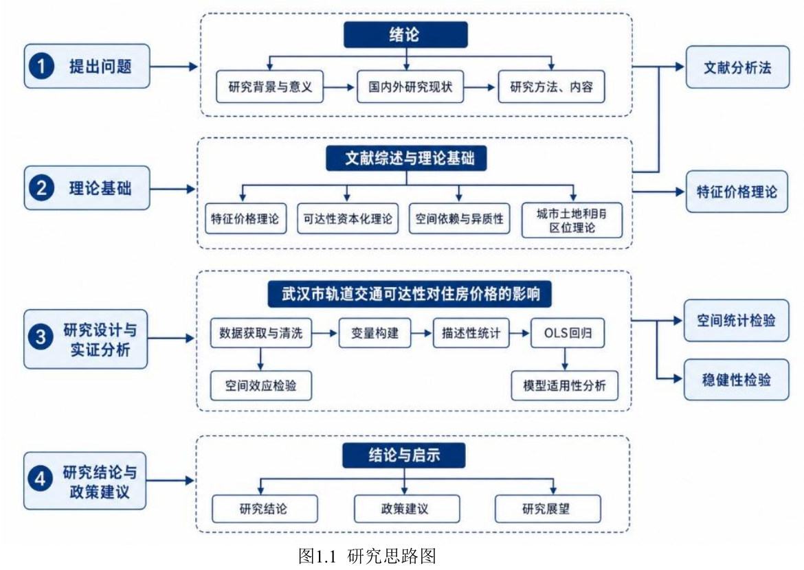
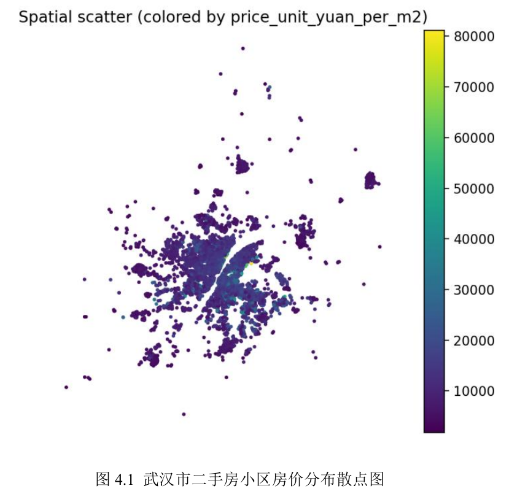
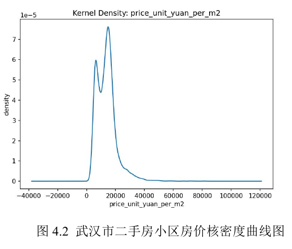

PYTHON · HEDONIC PRICING · SPATIAL ANALYSIS

本项目以武汉市住宅小区为分析单元，研究社区属性、区位差异与轨道交通可达性如何关联二手房价格。分析以 OLS 特征价格模型为主，并使用 Moran's I 检验模型残差中的空间相关性。

::: {.project-meta}
**项目状态：** 已完成研究，公开展示脱敏后的方法与汇总结果 
**数据来源：** 自行采集的安居客小区信息、高德地图地铁 POI 
**技术与方法：** Python · GeoPandas · OLS · HC0 · VIF · Moran's I · GIS
:::

::: {.metrics-grid}
::: {.metric-card}
1,071
住宅小区样本
:::

::: {.metric-card}
2024
小区数据年份
:::

::: {.metric-card}
0.752561
基准 OLS R²
:::

::: {.metric-card}
0.023299
KNN 残差 Moran's I
:::
:::

## 研究问题

轨道交通往往与商业成熟度、公共服务和中心城区区位同时出现。仅比较“是否临近地铁”容易将这些因素混在一起。本项目关注两个更具体的问题：

1. 在控制社区品质、开发强度、地区和商圈差异后，轨道交通可达性是否仍与小区价格相关？
2. 站点数量和最近接入距离，哪一种指标对价格差异更有解释力？

本项目识别的是横截面数据中的**相关关系**，不将回归结果解释为地铁建设对房价的因果效应。

## 数据与分析单元

分析整合两类数据：自行采集并清洗的 2024 年武汉住宅小区信息，以及通过高德地图 POI 构建的地铁站和地铁出入口信息。删除关键变量缺失记录后，最终样本包含 1,071 个住宅小区。

| 数据模块 | 主要内容 | 在分析中的作用 |
|---|---|---|
| 小区属性 | 单位面积价格、竣工年份、绿化率、容积率、物业费、总户数、总建筑面积、产权年限 | 构建因变量与社区结构控制变量 |
| 区位信息 | 地区、商圈、经纬度 | 控制区域差异并支持空间计算 |
| 轨道交通 POI | 地铁站、地铁出入口 | 构建缓冲区计数与最近距离指标 |

::: {.evidence-note}
原始数据、精确地址和坐标不在本网站公开。页面仅展示汇总后的研究设计与结果，避免传播未经授权的平台数据或可定位到具体小区的记录。
:::

## 研究思路与数据图示

下图来自项目论文中的研究思路图，展示了从问题提出、理论基础到数据处理、模型估计和空间检验的完整路径。

{fig-cap="研究思路与技术路线" fig-alt="研究从问题提出、理论基础、实证分析到结论与启示的流程图" .project-figure}

::: {.figure-grid}
{fig-cap="武汉市二手房小区房价分布散点图" fig-alt="武汉住宅小区价格空间散点图" .project-figure}

{fig-cap="武汉市二手房小区房价核密度曲线图" fig-alt="武汉住宅小区单位面积价格核密度曲线" .project-figure}
:::

图像来自论文中生成的汇总图表。空间散点图只作为静态展示，不提供底层小区坐标、地址或可下载点位数据。

## 数据处理流程

::: {.workflow-list}
::: {.workflow-step}
01
<h3>清洗与标准化</h3>

识别 CSV 编码和分隔符，统一缺失值，解析价格、年份和费用字段，并按“小区名称 + 地址”去重。
:::

::: {.workflow-step}
02
<h3>坐标与质量检查</h3>

修正可能互换的经纬度，检查武汉区域范围，生成缺失率、描述统计和空间分布质量报告。
:::

::: {.workflow-step}
03
<h3>POI 特征构建</h3>

将小区坐标与高德 POI 对齐，在米制投影下计算 500、1000、2000 米缓冲区计数和最近距离。
:::

::: {.workflow-step}
04
<h3>建模与空间诊断</h3>

建立 OLS 模型，使用 HC0 稳健标准误和 VIF 诊断，并对残差执行 KNN 与 IDW Moran's I 检验。
:::
:::

## 模型设定

因变量为小区单位面积价格的对数。连续解释变量进行 z-score 标准化；物业费采用 IQR 截尾后的变量。模型同时控制地区和商圈虚拟变量，并使用 HC0 稳健标准误处理潜在异方差。

轨道交通可达性包含：

- 500、1000、2000 米范围内的地铁站数量；
- 500、1000、2000 米范围内的地铁出入口数量；
- 到最近地铁站和最近地铁出入口的距离，进入模型前进行 `log1p` 变换。

### 基准 OLS 模型

模型以小区单位面积价格的对数为因变量，控制社区结构变量、轨道交通可达性变量、地区虚拟变量和商圈虚拟变量：

$$
\log(Price_i) = \beta_0 + \beta_1 Structure_i + \beta_2 Transit_i + \gamma District_i + \delta BusinessArea_i + \varepsilon_i
$$

连续变量进行 z-score 标准化，物业费使用 IQR 截尾后的变量，标准误采用 HC0 稳健估计。空间诊断阶段以 OLS 残差为输入，分别构建 KNN 和 IDW 权重矩阵计算 Moran's I；SAR 与 SEM 仅作为模型适用性比较，不作为最终解释模型。

### 模型选择对照

| 模型 | 在项目中的角色 | 论文报告的结果 | 最终处理 |
|---|---|---|---|
| OLS + HC0 | 基准特征价格模型 | `R² = 0.752561`，核心变量方向具有解释力 | **主模型** |
| SAR | 检查空间滞后项 | KNN/IDW 下出现较低拟合指标和异常系数 | 不作为主模型 |
| SEM | 检查空间误差项 | 空间参数接近 1，部分系数和标准误不稳定 | 不作为主模型 |

空间模型的不稳定主要与地区、商圈高维虚拟变量和空间权重的重叠解释有关；因此项目保留空间诊断结果，同时避免对不稳定空间参数作过度解释。

## 描述性统计

下表整理论文报告的主要变量描述性统计。数字来自归档论文，当前没有公开原始数据或输出文件用于重新计算。

| 变量 | N | 均值 | 标准差 | 最小值 | 最大值 |
|---|---:|---:|---:|---:|---:|
| 单位面积价格（元/平方米） | 1,071 | 14,789.707 | 5,589.317 | 3,000 | 57,416 |
| 对数单位面积价格 | 1,071 | 9.533 | 0.367 | 8.007 | 10.958 |
| 竣工年份 | 1,071 | 2,005.232 | 8.688 | 1,958 | 2,023 |
| 绿化率（%） | 1,071 | 30.507 | 7.332 | 10 | 80 |
| 容积率 | 1,071 | 2.294 | 1.190 | 0.28 | 9.95 |
| 截尾后物业费（元/平方米/月） | 1,071 | 1.499 | 0.897 | 0.1 | 4.9 |
| 总户数 | 1,071 | 755.924 | 1,120.674 | 3 | 9,179 |
| 最近地铁站距离（米） | 1,071 | 1,882.164 | 2,331.370 | 0 | 26,451.047 |
| 最近地铁出入口距离（米） | 1,071 | 2,241.481 | 3,602.497 | 0 | 44,335.412 |

## 核心回归结果

下表保留论文基准回归中的结构变量和轨道交通变量，系数为连续变量标准化后的估计值，标准误为 HC0 稳健标准误。

| 变量 | 系数 | HC0 稳健标准误 | t 值 | 显著性 |
|---|---:|---:|---:|:---:|
| 常数项 | 8.8347 | 0.0179 | 493.008 | *** |
| 竣工年份 | 0.0371 | 0.0153 | 2.4215 | ** |
| 绿化率 | 0.0444 | 0.0118 | 3.7652 | *** |
| 容积率 | -0.0387 | 0.0102 | -3.7903 | *** |
| 截尾后物业费 | 0.1243 | 0.0156 | 7.9531 | *** |
| 总户数 | -0.0168 | 0.0086 | -1.9547 | * |
| 总建筑面积 | 0.0233 | 0.0106 | 2.1883 | ** |
| 产权年限 | 0.0715 | 0.0094 | 7.6275 | *** |
| 500 米地铁站数量 | 0.0054 | 0.0062 | 0.8795 |  |
| 1000 米地铁站数量 | 0.0136 | 0.0099 | 1.3709 |  |
| 2000 米地铁站数量 | 0.0275 | 0.0195 | 1.4083 |  |
| 500 米地铁出入口数量 | -0.0103 | 0.0076 | -1.3602 |  |
| 1000 米地铁出入口数量 | 0.0032 | 0.0109 | 0.2939 |  |
| 2000 米地铁出入口数量 | -0.0121 | 0.0166 | -0.7259 |  |
| 最近地铁站距离（对数） | -0.0433 | 0.0121 | -3.5838 | *** |
| 最近地铁出入口距离（对数） | -0.0081 | 0.0154 | -0.5248 |  |
| 地区、商圈虚拟变量 | 已控制 |  |  |  |
| 样本量 | 1,071 |  |  |  |
| R² | 0.752561 |  |  |  |

`* p < 0.10`，`** p < 0.05`，`*** p < 0.01`。完整模型还包含地区和商圈虚拟变量；本页只展示论文中适合公开的核心变量。

## 主要结果

::: {.finding-banner}
### 最近接入距离比节点数量更有解释力

控制社区属性、地区和商圈差异后，最近地铁站距离的标准化系数为 **-0.0433**，并在 1% 水平显著。多个缓冲半径内的站点数量、出入口数量以及最近出入口距离未表现出稳定显著性。
:::

基准 OLS 使用 1,071 个样本，`R² = 0.752561`。社区品质与开发强度变量呈现不同方向的关联；完整核心变量系数和显著性见上方回归表。以上为项目报告中的模型估计，不代表因果关系。

## 空间诊断

OLS 残差在两种空间权重下都呈现统计显著但数值较弱的正空间相关。

| 权重矩阵 | 设定 | Moran's I | 正态近似 p | 999 次置换 p |
|---|---|---:|---:|---:|
| KNN | `k = 12`，行标准化 | 0.023299 | 0.0376 | 0.027 |
| IDW | 反距离权重，行标准化 | 0.007827 | 0.0283 | 0.027 |

该结果说明模型残差仍可能包含未充分观测的空间因素，但相关强度有限。项目进一步尝试 SAR 和 SEM；由于高维地区、商圈虚拟变量与空间权重存在识别冲突，模型出现极端参数和不稳定估计，因此最终保留 OLS 作为主模型，将空间检验作为辅助诊断。

## 分析结论

- 社区品质与开发强度是解释小区价格差异的重要组成部分。
- 轨道交通关联主要体现在到最近站点的接入便利性，而不是周边节点数量的简单增加。
- 地区和商圈差异仍具有较强解释力，交通条件不能脱离城市空间结构单独理解。
- 残差存在弱空间相关，但不足以支持使用数值不稳定的空间模型替代 OLS。

## 局限与后续工作

- 横截面数据只能支持相关性分析，无法严格识别轨道交通建设的因果效应。
- 学校、医院、公园、商业设施质量和街道环境等变量尚未纳入。
- 小区层面的平均价格会掩盖楼栋、户型、楼层和景观差异。
- 后续可结合线路开通时间和面板数据，使用 DID 等准实验方法增强因果识别。

## 公开与复现说明

本页面仅公开脱敏后的研究摘要。原始平台数据、完整地址、精确坐标、API 凭据和完整研究文档均不随网站发布。历史高德 API Key 已废止；任何后续公开代码都会改为环境变量配置。

当前归档模型脚本仍保留原始物业费字段口径，而最终模型确认采用 IQR 截尾后的物业费。完成代码口径校正、依赖整理和输出复核前，本网站不提供可下载的完整分析代码。部分实证代码曾使用生成式 AI 辅助，方法选择、数据处理与结果核验由研究者完成。

::: {.evidence-note}
**证据状态：** 页面中的样本规模、描述统计和模型结果来自项目归档报告；由于公开材料不包含原始数据和模型输出，本网站未重新运行并独立复现这些数值。
:::
